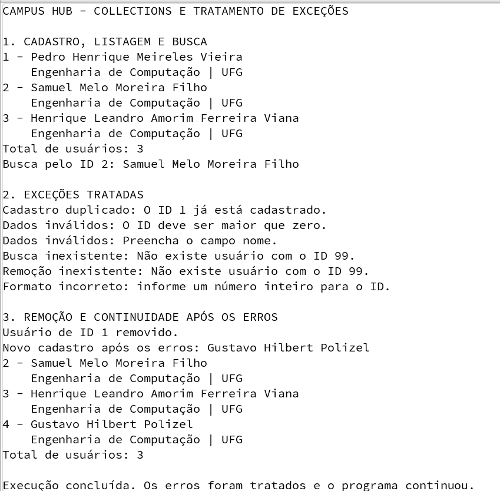

## Collections Framework e Tratamento de Exceções

## 1. Entidade e funcionalidades

A entidade `Usuario` possui os atributos `id`, `nome`, `curso` e `universidade`. A classe `UsuarioColecao` permite adicionar, listar, buscar e remover usuários pelo ID.

Os testes utilizam os mesmos nomes do projeto MVC: Pedro Henrique Meireles Vieira, Samuel Melo Moreira Filho, Henrique Leandro Amorim Ferreira Viana e Gustavo Hilbert Polizel. Todos os registros válidos utilizam **Engenharia de Computação** e **UFG**.

A coleção funciona em memória, de forma independente do banco SQLite. Nessa execução, os IDs são definidos pelo programa de teste. Na interface original, continuam sendo gerados pelo banco.

## 2. Coleção utilizada e justificativa

Foi utilizado `HashMap<Integer, Usuario>`, com o ID como chave e o usuário como valor. Essa estrutura permite localizar, verificar e remover registros diretamente pelo identificador, com custo médio O(1). A ordem da listagem não é garantida.

Antes de adicionar um usuário, a coleção verifica se a chave já existe para impedir a substituição de um cadastro. A listagem é retornada como `ArrayList`, e cópias dos objetos protegem os registros contra alterações externas nos setters da entidade.

## 3. Exceções tratadas

- `CadastroDuplicadoException`: ID já cadastrado.
- `DadosInvalidosException`: usuário nulo, ID não positivo ou campo obrigatório vazio.
- `RegistroNaoEncontradoException`: usuário inexistente em uma busca ou remoção.
- `NumberFormatException`: tentativa de converter uma entrada não numérica para ID.

As três primeiras exceções são personalizadas. Os métodos responsáveis pelas regras de negócio lançam exceções em vez de apenas imprimir mensagens ou retornar `null` em caso de erro. A camada de coleção utiliza `throw` e `throws` para sinalizar os erros. O programa `TesteUsuarioCollections` usa `try/catch` para apresentar mensagens e continuar a execução após as falhas previstas.

## 4. Testes de funcionamento

O programa demonstra três etapas:

1. Cadastro de usuários, listagem e busca de um ID existente.
2. Tratamento de cadastro duplicado, ID inválido, nome vazio, busca e remoção inexistentes e formato incorreto.
3. Remoção de um usuário, novo cadastro e listagem após os erros tratados.

A execução termina com três usuários na coleção. O teste não abre nem modifica o banco de dados.



## 5. Execução

### BlueJ

1. No BlueJ, abra a pasta interna `CampusHub-Collections-BlueJ`, que contém `package.bluej`, e clique em **Compilar**.
2. Clique com o botão direito em `TesteUsuarioCollections`.
3. Selecione `void main(String[] args)` e confirme os argumentos `{}`.

Os resultados são apresentados no terminal do BlueJ. As bibliotecas do projeto MVC estão incluídas em `+libs`. A versão foi compilada com JDK 21 e JavaFX 23.0.2 da instalação do BlueJ.

### Terminal do Windows

Na pasta interna `CampusHub-Collections-BlueJ`, onde está `executar.ps1`:

```powershell
powershell -ExecutionPolicy Bypass -File .\executar.ps1
```

O script utiliza a instalação padrão do BlueJ. Para outro local, informe `-BlueJ 'D:\BlueJ'`. Para iniciar a interface original, utilize `-Modo app`.
