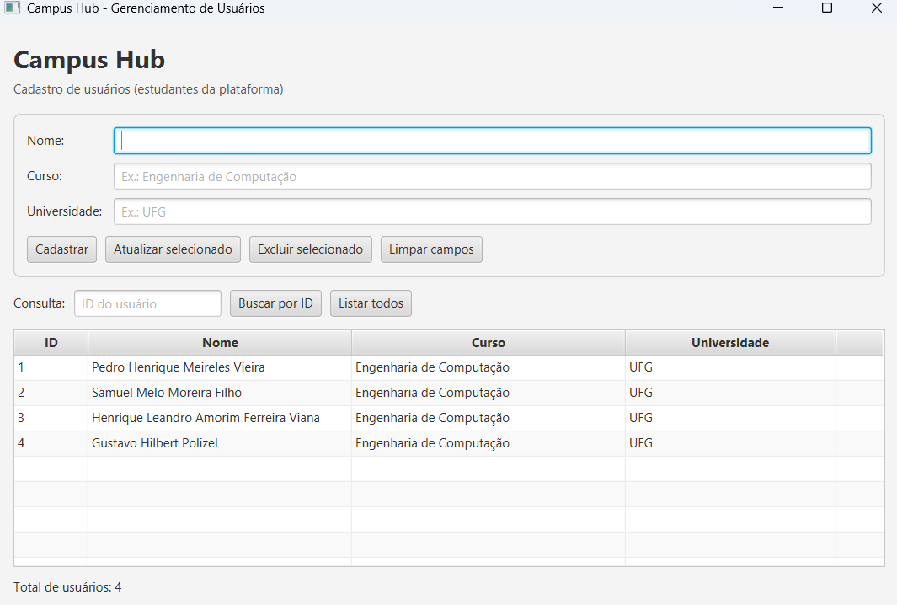
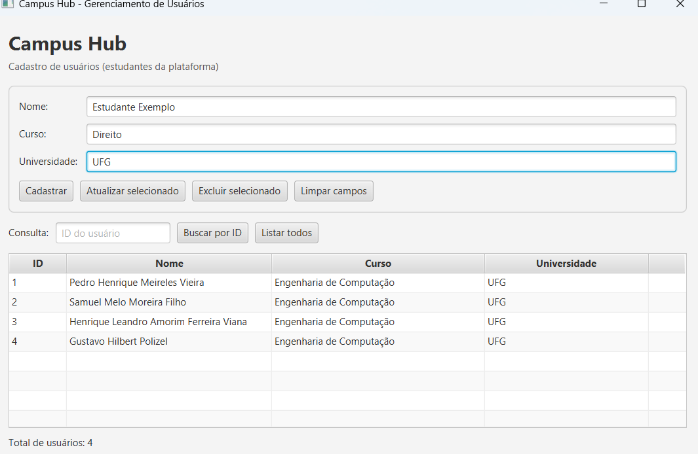
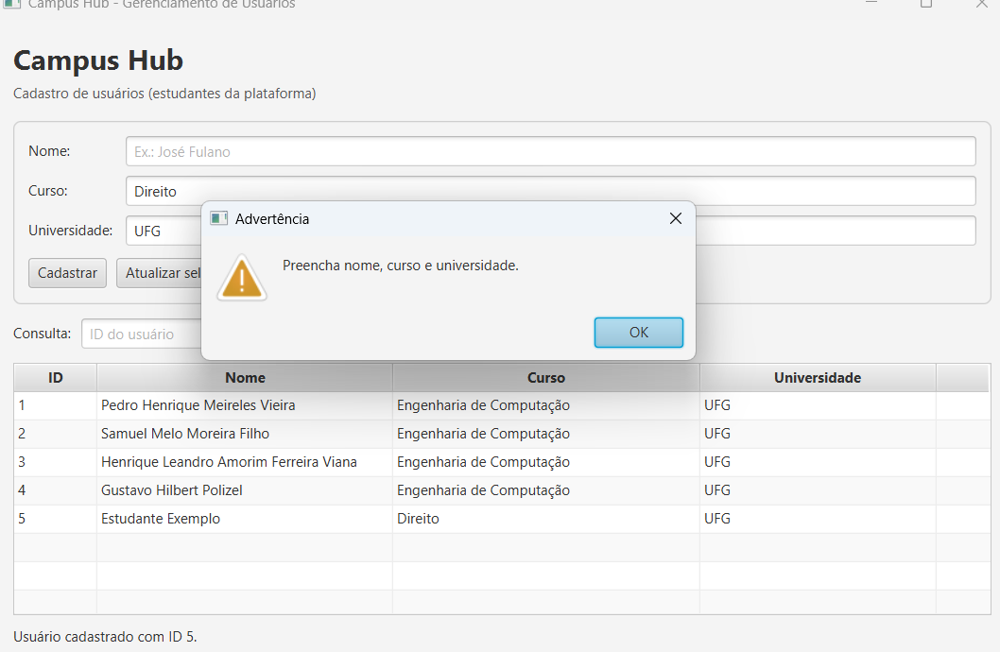
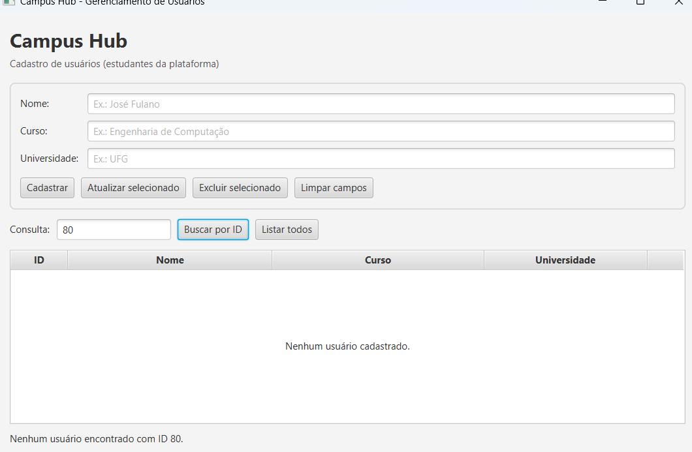
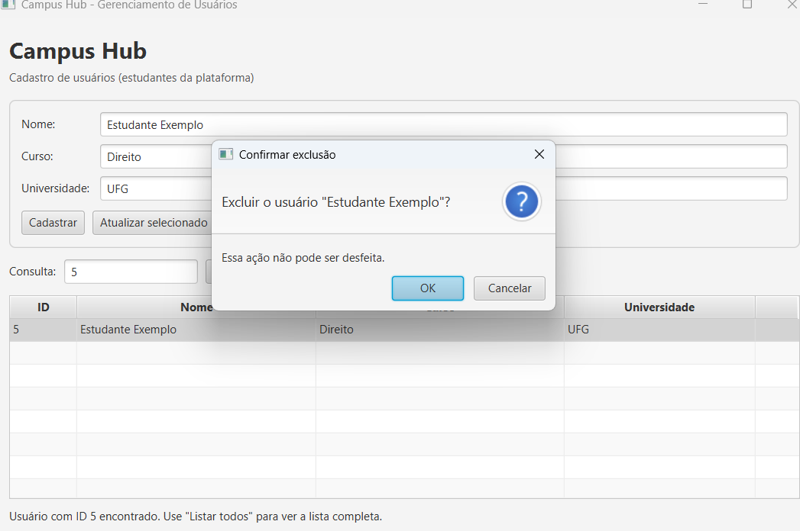

## Objetivo

Cadastrar e listar estudantes usando **JavaFX, ORMLite e SQLite**, com organização em MVC.

## Arquitetura MVC

- `model/Usuario.java`: entidade mapeada para a tabela `usuarios`.

- `model/Database.java`: gerenciamento da conexão SQLite.

- `model/UsuarioRepository.java`: operações de persistência com ORMLite.

- `view/UsuarioView.java`: formulário, `TableView` e mensagens.

- `controller/UsuarioController.java`: validação, ações e atualização da visão.

- `CampusHubInterface.java`: inicialização e integração das camadas.

## Atributos

- **ID:** gerado automaticamente.

- **Nome, curso e universidade:** campos obrigatórios, com remoção de espaços no início e no fim.

## Banco de dados

Os registros são armazenados em `campushub.db`, localizado relativamente ao diretório de execução. O script `executar.ps1` utiliza a pasta do projeto.

Se o arquivo não existir, o ORM cria um banco com uma tabela vazia. Preserve-o para manter os registros.

## Testes automatizados

- **MainTesteCRUD:** verifica cadastro, consulta, listagem, persistência após reabrir a conexão, atualização e exclusão.

- **TesteInterface:** verifica cadastro pelo botão, atualização da tabela, limpeza do formulário, recuperação dos registros e busca por ID. Requer sessão gráfica disponível.

Os testes utilizam bancos temporários e não alteram `campushub.db`. Execute-os pelo terminal para não bloquear a thread JavaFX do BlueJ.

## Capturas dos testes

### 1. Listagem dos registros

### 2. Cadastro de um estudante

### 3. Validação dos campos obrigatórios

O cadastro com campo vazio apresenta um aviso e não insere o registro.

### 4. Busca por ID inexistente

A consulta por um ID inexistente deixa a tabela sem resultados.

### 5. Exclusão de um estudante

## Referência

[Tutorial JavaFX CRUD](https://github.com/marceloakira/tutorials/tree/main/javafx-crud)

