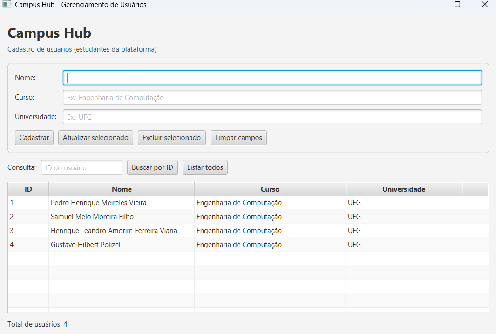
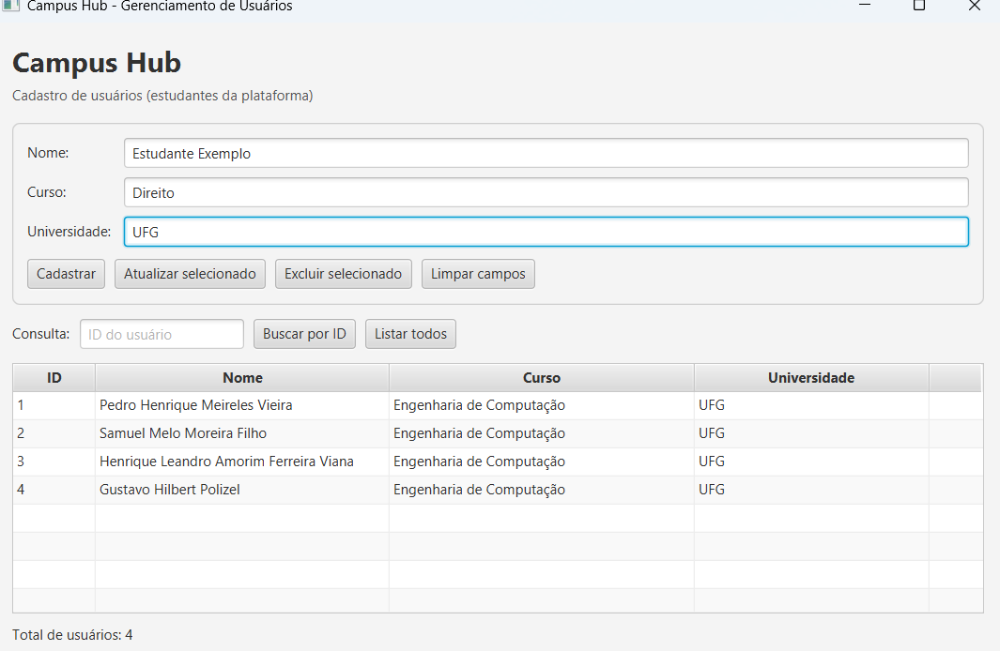
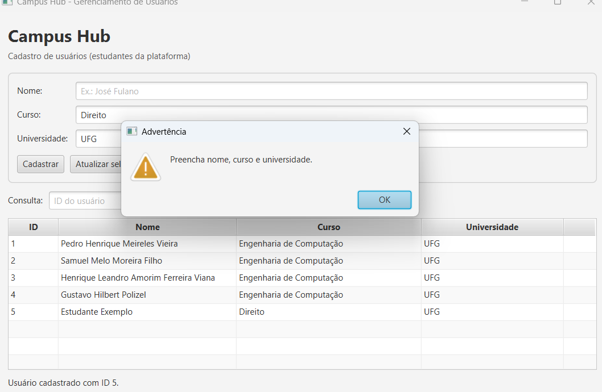
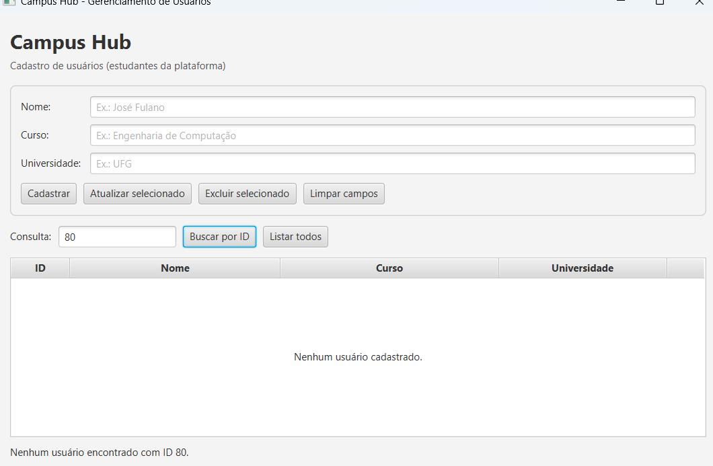
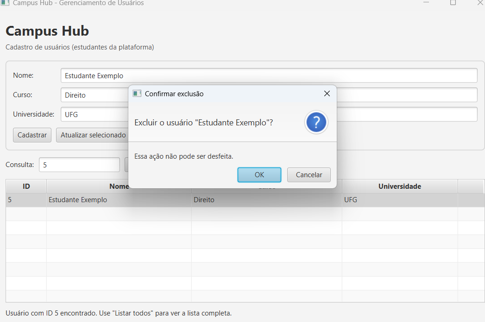

# Atividade JavaFX / MVC / ORM

## Objetivo

Cadastrar e listar usuários (estudantes) usando **JavaFX, ORMLite e SQLite**.

## Arquitetura MVC

Os caminhos abaixo são relativos à pasta CampusHubBj-MVC/.

- `model/Usuario.java`: entidade mapeada para a tabela `usuarios` pelo ORMLite.
- `model/Database.java`: abertura e fechamento da conexão SQLite.
- `model/UsuarioRepository.java`: operações de persistência pelo DAO do ORMLite.
- `view/UsuarioView.java`: formulário, `TableView` e apresentação de mensagens.
- `controller/UsuarioController.java`: validação, ações e atualização da visão.
- `CampusHubInterface.java`: inicialização da aplicação e conexão das camadas.

## Atributos

ID autogerado, nome, curso e universidade, conforme a entidade Java enviada.

Os três campos do formulário são obrigatórios. Espaços nas pontas são removidos.

## Banco de dados

O arquivo `campushub.db` é localizado relativamente ao diretório de execução. O script `executar.ps1` usa sempre a pasta do projeto.

Não remova esse arquivo se quiser manter seus registros. Sem ele, o ORM cria um novo banco e uma tabela vazia.

## Testes automatizados

- **MainTesteCRUD**: verifica criação, consulta, listagem, atributos após fechar e reabrir o banco, atualização e exclusão.
- **TesteInterface**: inicia JavaFX, aciona o botão **Cadastrar** e verifica a `TableView`, a limpeza do formulário, a recuperação por nova conexão, a busca sem resultado e o retorno da listagem completa. Requer sessão gráfica disponível.

Ambos usam bancos temporários e não modificam `campushub.db`.

Execute os testes pelo terminal para não bloquear a thread JavaFX do BlueJ.

## Testes realizados

### 1. Listagem dos registros

Abrir a aplicação e conferir os registros existentes.

### 2. Cadastro de um estudante

Cadastrar um estudante fictício e conferir o ID gerado na tabela.

### 3. Validação dos campos obrigatórios

Tentar cadastrar com um campo vazio: aparece um aviso, sem inserção.

### 4. Busca por ID inexistente

Buscar um ID inexistente: a tabela deve ficar sem resultados.

### 5. Exclusão de um estudante

Excluir um estudante cadastrado.

## Referência

[Tutorial JavaFX CRUD](https://github.com/marceloakira/tutorials/tree/main/javafx-crud)
